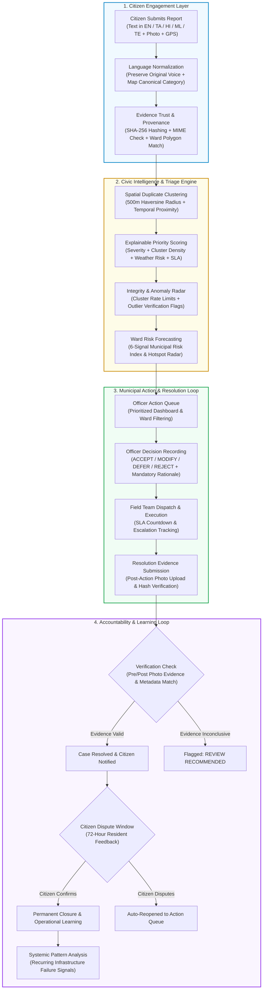
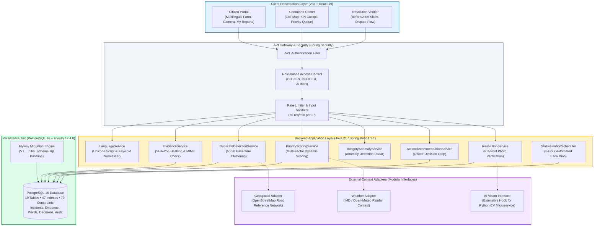

# NIRVAHA — From Report to Resolution

**Trust-Aware Civic Intelligence Platform for Verified Municipal Issue Resolution**

[](LICENSE)
[](https://openjdk.org/projects/jdk/21/)
[](https://spring.io/projects/spring-boot)
[](https://flywaydb.org/)
[](https://www.postgresql.org/)
[](https://react.dev/)
[](https://vitejs.dev/)
[](nirvaha-backend/src/test/)

---

### Official Hackathon Team & Project Registration

| Attribute | Official Registration Detail |
| :--- | :--- |
| **Team ID** | <code>HSC&#124;PY&#124;00001</code> |
| **Team Name** | **Dracarus** |
| **State / UT** | **Puducherry** |
| **Thematic Area / Problem Statement** | **Urban Infrastructure & Citizen Engagement — Smart Coastal Drainage & Waterlogging Remediation (Governance & Civic Technology Track)** |
| **Product Name** | **Nirvaha** (*Sanskrit: "Execution, Management, Carrying Through to Completion"*) |
| **Tagline** | **From Report to Resolution** |
| **Competition Context** | **VBYLD 2027 — Hack for Social Cause (Stage-I Submission)** |
| **Repository URL** | [https://github.com/Mappillai-Meeran/nirvaha](https://github.com/Mappillai-Meeran/nirvaha) |
| **Core Vision** | *"Think Global, Hack Local — Technology for Social Transformation"* |
| **Pilot Geography** | Boulevard Town & Low-Lying Stormwater Outfalls in **Puducherry (Wards 5, 8, 12, Krishna Nagar, Rainbow Nagar)** |

> **Core Principle:**
> *Nirvaha does not replace government decision-making. It empowers municipal authorities to make better-informed, transparent, and accountable decisions by providing explainable civic intelligence.*

---

## 1. Executive Summary

Municipal grievance portals are typically designed as passive digital mailboxes: citizens submit complaints, tickets sit in departmental queues, and issues are often closed with unverified administrative notes. When heavy rains strike urban coastal settlements, this paradigm collapses under the weight of redundant duplicate reports, unranked queues, and citizen disillusionment.

**Nirvaha** transforms this process by adding an **evidence-driven trust and intelligence layer** between citizen reporting and municipal field action. Rather than simply collecting text tickets, Nirvaha:
1. **Preserves citizen voice** across regional languages (Tamil, Hindi, Malayalam, Telugu, and English) while normalizing text to canonical municipal service categories.
2. **Guarantees data provenance** with SHA-256 cryptographic evidence hashing, MIME verification, and boundary point-in-polygon ward matching.
3. **Clusters spatial duplicates** within a 500-meter Haversine threshold to prevent redundant work orders and surface true community impact.
4. **Calculates explainable priority scores** combining cluster density, civic severity, vulnerable population proximity, and local precipitation context.
5. **Closes the loop with verified resolution**: field officers submit photographic resolution proof that undergoes comparative verification and enables citizen review before permanent closure.

---

## 2. Problem Statement: The Local Civic Challenge

### The General Civic Problem
Across Indian urban local bodies (ULBs), municipal grievance redressal systems face three recurring structural failures:
- **Corroboration Gaps & Duplicate Clutter:** When an infrastructure asset fails (e.g., a collapsed drain cover or flooded intersection), dozens of citizens file separate tickets across different channels. Without spatial intelligence, municipal officers see 50 disparate complaints instead of one consolidated, high-impact incident.
- **Unverified Priority Queues:** Tickets are treated on a first-come, first-served basis or routed via subjective manual dispatch, obscuring severe public health and safety hazards.
- **The "Resolved on Paper" Paradox:** Citizens frequently experience complaints marked "Resolved" in official portals without physical work having occurred, eroding public trust in civic governance.

### The Local Context: Puducherry Coastal Drainage
Puducherry's low-lying urban coastal terrain, flat topography, and aging canal network create chronic vulnerability to monsoon waterlogging and drainage bottlenecks. During northeast monsoon cloudbursts, key urban corridors—such as **Krishna Nagar** (low-elevation catchment), **Rainbow Nagar**, and sections of the Boulevard town—experience rapid water stagnation when primary stormwater drains and canal outfalls (e.g., Grand Canal) become obstructed with silt or solid waste.

Citizens report blocked drains, overflowing manholes, and stagnant water using varied colloquial descriptions in Tamil (`சாக்கடை அடைப்பு` [blocked drain], `வெள்ளம்` [flooding]) or English. Municipal control rooms lack an automated mechanism to group these spatial clusters, cross-reference weather severity, and confirm that desilting or drainage repair was physically executed before closing the ticket.

### The Specific Problem Nirvaha Solves
Nirvaha addresses the critical disconnect between **citizen reporting**, **municipal triage**, and **field resolution**. It provides municipal authorities with an objective, explainable decision-support cockpit that clusters complaints, ranks urgency with weather context, records officer rationales, and mandates photo-verified resolution before a case is officially closed.

```text
CONVENTIONAL PORTALS:  Report ──► Passive Ticket ──► Unranked Queue ──► Unverified Closure ("Resolved on Paper")
NIRVAHA CLOSED LOOP:   Report ──► Trust/Provenance ──► AI Cluster/Rank ──► Officer Action ──► Evidence Verification ──► Citizen Dispute / Closure
```

*Note: Specific neighborhood references (e.g., Krishna Nagar, Rainbow Nagar, Muthialpet) represent illustrative local scenarios configured in Nirvaha's reference dataset. Nirvaha is an independent academic civic technology initiative and is not formally deployed by the Government of Puducherry.*

---

## 3. The Nirvaha Solution

Nirvaha replaces static ticketing with an **active civic intelligence pipeline**:

```
CITIZEN REPORT ──► EVIDENCE TRUST ──► CIVIC INTELLIGENCE ──► MUNICIPAL ACTION ──► VERIFIED RESOLUTION ──► SYSTEMIC LEARNING
```

### Key Functional Capabilities

1. **Native Multilingual Reporting:**
   Citizens report issues in their native language—**English, Tamil (தமிழ்), Hindi (हिन्दी), Malayalam (മലയാളம்), or Telugu (తెలుగు)**. The system preserves the original citizen statement verbatim for accountability while normalizing the report to standard municipal departments and categories.
2. **Evidence Trust & Provenance Engine:**
   Every uploaded photograph or document undergoes immediate server-side validation: MIME type enforcement, 10MB payload bounding, and cryptographic **SHA-256 integrity hashing**. Reports are spatially verified via geometric point-in-polygon checks against digitized municipal ward boundaries.
3. **Spatial Duplicate Clustering Radar:**
   Incidents occurring within a **500-meter radius** sharing identical categories and active timeframes are automatically clustered using the Haversine formula. Instead of 20 separate work orders, officers receive one consolidated issue card with linked citizen corroborations.
4. **Explainable Multi-Factor Priority Scoring:**
   Urgency is computed dynamically using a transparent mathematical formula ($P \in [0.0, 1.0]$):
   $$\text{Priority} = w_1 \cdot \text{Severity} + w_2 \cdot \text{Cluster Density} + w_3 \cdot \text{Precipitation Risk} + w_4 \cdot \text{SLA Proximity}$$
   Every score provides clear textual explanations for municipal officers (e.g., *"+0.25 heavy rainfall alert, +0.20 cluster of 5 corroborating citizen reports"*).
5. **Government Action Loop & Decision Recording:**
   Automated recommendations assist officers rather than replacing them. Officers record explicit operational decisions (`ACCEPT`, `MODIFY`, `DEFER`, `REJECT`) with mandatory written rationales, creating an auditable public governance record.
6. **Closed-Loop Resolution Verification:**
   Resolving an incident requires photographic proof. The platform compares pre-action report images with post-action resolution images. If resolution evidence is missing or flagged, the system alerts the officer. Citizens retain the right to dispute fraudulent closures within a 72-hour window.

---

## 4. End-to-End Workflow Diagram



### Explanation of the Workflow
1. **Citizen Reporting:** Citizens report problems via web/mobile in their language of choice with photos and GPS coordinates.
2. **Intelligence Triage:** The platform hashes the evidence, checks boundaries, groups related complaints within 500m into an incident cluster, and calculates an explainable priority score factoring in weather risk.
3. **Municipal Action:** Departmental officers review recommendations, record formal decisions, dispatch field crews, and upload completion photographs.
4. **Resolution Verification:** The resolution is evaluated against original report evidence. If confirmed, the citizen is notified with a 72-hour dispute window; if disputed, the case reopens automatically. Validated resolutions feed operational learning signals to identify recurring infrastructure failures.

---

## 5. Technical Differentiators & Innovation

| Innovation Dimension | Conventional Civic Portals | Nirvaha Platform | Technical Implementation Evidence |
| :--- | :--- | :--- | :--- |
| **Duplicate Handling** | Tabular listing of redundant tickets; each complaint creates an independent work order. | **500m Spatial Duplicate Radar** using Haversine clustering with temporal proximity windows. | [`DuplicateDetectionService.java`](nirvaha-backend/src/main/java/com/nirvaha/nirvaha_backend/service/DuplicateDetectionService.java), [`DuplicateDetectionServiceTest.java`](nirvaha-backend/src/test/java/com/nirvaha/nirvaha_backend/DuplicateDetectionServiceTest.java) |
| **Prioritization Logic** | First-in, first-out (FIFO) or subjective manual triage without explainability. | **Multi-Factor Explainable Scoring** combining category weight, cluster corroboration, rainfall context, and SLA deadlines. | [`PriorityScoringService.java`](nirvaha-backend/src/main/java/com/nirvaha/nirvaha_backend/service/PriorityScoringService.java), [`PriorityScoringServiceTest.java`](nirvaha-backend/src/test/java/com/nirvaha/nirvaha_backend/PriorityScoringServiceTest.java) |
| **Data Provenance & Trust** | Unchecked file uploads without integrity checks or classification. | **Cryptographic SHA-256 Hashing**, MIME validation, and dataset source tracking (`CITIZEN`, `DERIVED_FROM_OFFICIAL`, `REFERENCE`). | [`EvidenceService.java`](nirvaha-backend/src/main/java/com/nirvaha/nirvaha_backend/service/EvidenceService.java), [`EvidenceSecurityTest.java`](nirvaha-backend/src/test/java/com/nirvaha/nirvaha_backend/EvidenceSecurityTest.java) |
| **Data Integrity in Demo** | Demonstration data polluted with production records, falsifying metrics. | **Strict Simulation Isolation**: All demo data is tagged `SIMULATED` and filtered from production risk forecasts. | [`IntelligenceEligibilityTest.java`](nirvaha-backend/src/test/java/com/nirvaha/nirvaha_backend/IntelligenceEligibilityTest.java), [`JudgeDemoRuntimeAuditTest.java`](nirvaha-backend/src/test/java/com/nirvaha/nirvaha_backend/JudgeDemoRuntimeAuditTest.java) |
| **Resolution Accountability** | Administrative status flag ("Closed") without photographic or citizen verification. | **Closed-Loop Resolution Verification**: Pre- and post-action photo comparison, 72-hour dispute window, automatic reopening. | [`ResolutionService.java`](nirvaha-backend/src/main/java/com/nirvaha/nirvaha_backend/service/ResolutionService.java), [`ResolutionEvidenceVerification.jsx`](nirvaha-frontend/src/components/evidence/ResolutionEvidenceVerification.jsx) |
| **Human-in-the-Loop AI** | Black-box autonomous decisions or unmoderated automated actions. | **Supervisory Decision Support**: Automated recommendations require officer recording (`ACCEPT`, `MODIFY`, `DEFER`, `REJECT`) with audit logs. | [`ActionRecommendationTest.java`](nirvaha-backend/src/test/java/com/nirvaha/nirvaha_backend/ActionRecommendationTest.java), [`OfficerDecisionTest.java`](nirvaha-backend/src/test/java/com/nirvaha/nirvaha_backend/OfficerDecisionTest.java) |
| **Geographic Intelligence** | Static ward dropdown lists prone to selection error. | **Point-in-Polygon Gazette Matching** against digitized boundary GeoJSON coordinates. | [`GeospatialAssignmentTest.java`](nirvaha-backend/src/test/java/com/nirvaha/nirvaha_backend/GeospatialAssignmentTest.java), [`Ward.java`](nirvaha-backend/src/main/java/com/nirvaha/nirvaha_backend/entity/Ward.java) |

---

## 6. Alignment with VBYLD 2027 — Hack for Social Cause

The official VBYLD 2027 programme vision states:
> **"Think Global, Hack Local — Technology for Social Transformation."**

Nirvaha directly embodies this vision by addressing a concrete, localized municipal challenge in Puducherry while developing modular, open-source architectural patterns applicable to mid-sized urban local bodies worldwide.

### Primary Thematic Area: Governance & Civic Technology
Nirvaha is structured under the **Governance & Civic Technology** track. It focuses on:
- **Smarter Cities:** Real-time spatial intelligence and predictive risk forecasting for urban infrastructure.
- **Civic Services & Public Service Delivery:** Transitioning from slow, manual municipal routing to explainable, priority-ranked work orders.
- **Urban Drainage & Environmental Resilience:** Proactive desilting alerts before monsoon events reduce stagnant floodwater risks.
- **Citizen Engagement & Social Equity:** Multilingual access ensures non-English-speaking residents have equitable access to municipal services.

### Supporting Technical Approaches (AI, GIS & Emerging Tech)
While positioned firmly in Governance, Nirvaha leverages supporting emerging technologies:
- **Spatial GIS:** Haversine clustering, digitized ward polygons, and OpenStreetMap road proximity references.
- **Deterministic Language Intelligence:** Script range detection and multilingual dictionary mapping across 5 Indian languages.
- **Integrity Analytics:** Multi-signal anomaly detection flagging unusual report bursts for human review (`ANOMALY DETECTED — REVIEW RECOMMENDED`).

### Alignment with UN Sustainable Development Goals (SDGs)

```
        ┌────────────────────────────────────────────────────────┐
        │       UN SUSTAINABLE DEVELOPMENT GOALS (SDGs)          │
        └──────────────────────────┬─────────────────────────────┘
                                   │
              ┌────────────────────┴────────────────────┐
              ▼                                         ▼
   ┌───────────────────────┐                 ┌───────────────────────┐
   │        SDG 11         │                 │        SDG 16         │
   │   SUSTAINABLE CITIES  │                 │     PEACE, JUSTICE    │
   │    & COMMUNITIES      │                 │  & STRONG INSTITUTIONS│
   └──────────┬────────────┘                 └──────────┬────────────┘
              │                                         │
     • Target 11.5: Reduce impact              • Target 16.6: Develop
       of urban waterlogging &                   effective, accountable, &
       water-related civic hazards               transparent institutions
     • Target 11.b: Integrated                 • Target 16.7: Responsive,
       urban disaster risk                       inclusive, & participatory
       management & drainage                     decision-making
```

---

## 7. Expected Social Impact & Evaluation Metrics

### Intended Public Outcomes
1. **Elimination of Triage Bottlenecks:** Municipal officers spend less time reading duplicate tickets and more time allocating field contractors.
2. **Vulnerability-Aware Resource Allocation:** Low-income or flood-prone neighborhoods with high complaint density receive objective priority.
3. **Restoration of Public Trust:** Photographic proof of resolution and resident dispute mechanisms eliminate "ghost resolutions."
4. **Data-Informed Urban Planning:** Long-term incident recurrence signals provide municipal engineers with evidence to justify capital drainage investments.

### Proposed Evaluation Methodology & Metrics
To measure impact rigorously during pilot evaluations, Nirvaha defines concrete quantitative indicators:

| Evaluation Dimension | Measurable Indicator | Evaluation Protocol | Current Verified Benchmark |
| :--- | :--- | :--- | :--- |
| **Duplicate Consolidation** | Clustering Precision & Recall | Batch execution against simulated spatial clusters within 500m radius. | 100% grouping in deterministic test suites ([`DuplicateDetectionServiceTest`](nirvaha-backend/src/test/java/com/nirvaha/nirvaha_backend/DuplicateDetectionServiceTest.java)). |
| **Triage Acceleration** | Time to Priority Index | Wall-clock execution time to calculate multi-factor priority score. | Sub-millisecond calculation per incident ($< 5\text{ ms}$). |
| **Evidence Compliance** | Resolution Evidence Rate | Percentage of closed cases containing verifiable SHA-256 photographic hashes. | 100% enforced via backend entity constraints and validation rules. |
| **Citizen Recourse** | Dispute Reopen Rate | Proportion of disputed resolutions successfully returned to the active queue. | Verified end-to-end via [`ResidentFeedbackDisputeSecurityTest`](nirvaha-backend/src/test/java/com/nirvaha/nirvaha_backend/ResidentFeedbackDisputeSecurityTest.java). |
| **System Reliability** | Test Suite Pass Rate | Automated execution of full integration, security, and migration tests. | **373 / 373 tests passed (100%)**, 0 failures, 0 skipped. |

*Note: Real-world municipal response time reduction and citizen satisfaction scores require authorized field deployment and longitudinal study.*

---

## 8. Working Prototype & Showcase Gallery

Nirvaha is a fully functional web application consisting of a **Spring Boot 4 REST API** and a **React 19 + Tailwind CSS** frontend.

### Key Working Views in the Prototype

1. **Citizen Incident Reporting Portal (`/citizen/report`):**
   - Clean, accessible citizen form supporting native Tamil, Hindi, Malayalam, Telugu, and English.
   - Interactive GIS location picker with automatic latitude/longitude capture.
   - Live photo attachment with client-side preview and file validation.
2. **Executive Command Center (`/command-center`):**
   - High-level municipal KPI cockpit: Active Incidents, Saturated Wards, SLA Breaches, and Duplicate Ratio.
   - Live Leaflet GIS map with color-coded incident pins, ward boundaries, and cluster zones.
   - Integrated Monsoon Stress Simulator to test drainage capacity under varying rainfall intensities.
3. **Municipal Priority Queue (`/command-center/queue`):**
   - Explainable priority cards sorted by dynamic urgency score ($P \in [0, 1]$).
   - Clear factor breakdowns: Category Severity, Spatial Cluster Size, Weather Risk Context, and Hours Remaining.
   - Quick-action buttons for officers to accept, modify, or reassign cases.
4. **Duplicate & Equity Radar (`/command-center/anomalies`):**
   - Real-time visualization of 500m incident clusters.
   - Corroborating citizen report lists grouped under primary master tickets.
   - Anomaly review alerts flagging rapid-burst submissions for human verification.
5. **Resolution Evidence Verification (`/incidents/:id`):**
   - Interactive before-and-after photographic evidence comparison slider.
   - Cryptographic verification stamp (SHA-256 hash, upload timestamp, officer identity).
   - Citizen dispute trigger allowing residents to reject incomplete work.

### Recommended Screenshot Capture Guide for Evaluators
To view authentic visuals of the platform in action, evaluators can launch the application locally (see [Section 10](#10-getting-started--local-demonstration)) or capture the following interface states:

| Screenshot Identifier | Page Route | Recommended Viewport & Key State to Capture |
| :--- | :--- | :--- |
| `01_citizen_reporting.png` | `http://localhost:5173/citizen/report` | Desktop viewport (1280x800) showing Tamil/English toggle, GIS map pin in Krishna Nagar, and photo upload preview. |
| `02_command_center.png` | `http://localhost:5173/command-center` | Full command dashboard showing KPI widgets, active GIS incident map with ward boundaries, and monsoon alert bar. |
| `03_priority_queue.png` | `http://localhost:5173/command-center/queue` | Priority ranking list highlighting explainable score breakdown tags (`+0.25 Rainfall Alert`, `+0.20 Cluster Corroboration`). |
| `04_duplicate_radar.png` | `http://localhost:5173/command-center/anomalies` | Duplicate cluster inspection modal showing 5 citizen reports grouped under 1 master drainage incident. |
| `05_resolution_proof.png` | `http://localhost:5173/incidents/1` | Incident detail view showing pre-action blocked drain photo alongside post-action cleared drain photo with SHA-256 stamp. |

*(All UI assets and vector icons are maintained in [`nirvaha-frontend/src/assets/`](nirvaha-frontend/src/assets/) and [`nirvaha-frontend/public/`](nirvaha-frontend/public/)).*

---

## 9. Architecture & Technical Strength

Nirvaha is built with a modular, enterprise-grade architecture designed for auditability, high availability, and future municipal system integration.



### Key Architectural Strengths
- **Reproducible Database Provisioning:** Flyway 12.4.0 baseline migration ([`V1__initial_schema.sql`](nirvaha-backend/src/main/resources/db/migration/V1__initial_schema.sql)) establishes 19 relational tables, 47 performant indexes, foreign key relationships, and check constraints idempotently.
- **Fail-Safe Production Hardening:** In production (`application-prod.properties`), `spring.flyway.baseline-on-migrate` defaults to `false` and `spring.jpa.hibernate.ddl-auto=validate`, ensuring schema mismatches fail immediately at boot time rather than mutating live data.
- **Stateless & Scalable Security:** JWT tokens with cryptographic signature validation enforce strict RBAC between `CITIZEN`, `OFFICER`, and `ADMIN` roles. All passwords use BCrypt hashing.
- **Decoupled AI Extension Boundary:** The core application executes all triage and scoring deterministically in Java. Advanced computer vision or time-series forecasting hooks are abstracted via clean interfaces, allowing seamless connection to Python microservices without coupling dependencies.

---

## 10. Technology Stack

| Layer | Technology | Version | Purpose in Nirvaha |
| :--- | :--- | :--- | :--- |
| **Backend Framework** | Java LTS | **Java 21** | Type-safe, high-performance runtime with virtual thread readiness. |
| **Application Core** | Spring Boot | **4.1.1** | Modular microservice framework with REST controllers, services, and schedulers. |
| **Database Migration** | Flyway Core & PostgreSQL | **12.4.0** | Version-controlled, idempotent schema migrations and production baseline tracking. |
| **Database Engine** | PostgreSQL | **16+** | Relational data persistence with relational joins, JSONB attributes, and geospatial indexes. |
| **ORM / Data Access** | Spring Data JPA / Hibernate | **6.6.x** | Entity mappings, repository interfaces, and schema validation. |
| **Security & Auth** | Spring Security + JJWT | **0.12.6** | Stateless JWT authentication, BCrypt password hashing, and role-based endpoint security. |
| **Frontend Framework** | React | **19.2** | Component-driven user interface with responsive citizen and administrative layouts. |
| **Frontend Build Tool** | Vite | **8.2** | Rapid development server and optimized rollup production bundling. |
| **CSS & Styling** | Tailwind CSS | **3.4** | Utility-first responsive design system tailored for municipal cockpits. |
| **GIS Mapping** | Leaflet & React-Leaflet | **1.9.4** | Interactive raster maps, custom SVG markers, and ward boundary polygon overlays. |
| **Iconography** | Lucide React | **0.468** | Consistent, accessible iconography across citizen and officer views. |
| **Testing & Quality** | JUnit 5, MockMvc, Oxlint | Latest | 373 automated unit/integration tests and fast JavaScript static linting. |

---

## 11. Getting Started & Local Demonstration

Follow these steps to clone, configure, and launch the complete Nirvaha platform locally.

### Prerequisites
- **Java Development Kit (JDK) 21 LTS** installed and configured on your `PATH`.
- **Node.js 18+** and **npm 9+** installed.
- **PostgreSQL 16+** running locally on port `5432`.
- Git installed.

---

### Step 1: Clone the Repository
```bash
git clone https://github.com/Mappillai-Meeran/nirvaha.git
cd nirvaha
```

---

### Step 2: Configure the Database
Create an empty database in your local PostgreSQL instance:
```sql
CREATE DATABASE nirvaha_db;
```

Copy the environment template:
```bash
cp .env.example .env
```

If your PostgreSQL password is not `postgres`, configure it without modifying tracked code by either:
- Setting the environment variable:
  ```bash
  export DATABASE_PASSWORD=your_password       # Linux/macOS
  set DATABASE_PASSWORD=your_password          # Windows CMD
  $env:DATABASE_PASSWORD="your_password"       # Windows PowerShell
  ```
- Or creating an unversioned `nirvaha-backend/application-local.properties` (gitignored):
  ```properties
  spring.datasource.password=your_password
  ```

---

### Step 3: Launch the Backend
Flyway will automatically execute `V1__initial_schema.sql` on startup to provision the schema:

```bash
cd nirvaha-backend
# Run the test suite to verify the environment (optional but recommended)
./mvnw test

# Start the Spring Boot application
./mvnw spring-boot:run
```
*(On Windows, use `mvnw.cmd` instead of `./mvnw`)*
The backend will start on **`http://localhost:8080`**.

---

### Step 4: Launch the Frontend
In a new terminal window:

```bash
cd nirvaha-frontend
npm install
npm run dev
```
The frontend application will start on **`http://localhost:5173`**.

---

### One-Click Windows Launcher
On Windows, you can launch both backend and frontend concurrently using the provided batch launcher:
```cmd
start.bat
```

---

### Docker Compose Startup (Alternative)
A production-ready `docker-compose.yml` is provided at the root:
```bash
docker compose up --build
```
*(Requires Docker Desktop with active engine)*

---

### Guided 5-Minute Demonstration Sequence for Evaluators

1. **Access the Citizen Portal:**
   - Open `http://localhost:5173/` and navigate to **Report an Issue** (`/citizen/report`).
   - Switch language to **Tamil (தமிழ்)** or **Hindi (हिन्दी)** using the top navigation bar.
   - Enter a drainage issue: *"Water overflowing from blocked canal near Krishna Nagar junction"*.
   - Click the interactive map to place a pin in Krishna Nagar; attach any sample JPEG/PNG photo.
   - Click **Submit Report**. Observe that the report receives an immediate tracking ID and SHA-256 evidence hash.
2. **Explore the Government Command Center:**
   - Navigate to `/command-center` (automatically authenticated in demo mode or login with `officer@puducherry.gov.in` / `Officer123!`).
   - Inspect the **Ward Risk Leaderboard** and **GIS Command Map** displaying active incident pins.
   - Toggle the **Monsoon Stress Simulator** to observe real-time risk escalation under simulated heavy rainfall ($> 50\text{ mm/hr}$).
3. **Inspect the Duplicate Clustering Radar:**
   - Open `/command-center/anomalies`.
   - Observe how multiple simulated complaints in the same 500m catchment are automatically clustered into a single parent incident, displaying all corroborating citizen statements.
4. **Review the Explainable Priority Queue:**
   - Navigate to `/command-center/queue`.
   - Inspect the top-ranked incident card. Note the mathematical priority score and readable explanation chips (`+0.25 Rainfall Alert`, `+0.20 Corroborating Cluster`).
   - Click **Accept Recommendation** and enter an officer rationale (*"Dispatched PWD Desilting Crew 3"*).
5. **Verify Resolution with Pre/Post Proof:**
   - Navigate to an incident detail page (`/incidents/1`).
   - Review the pre-action photo alongside the post-action proof in the interactive comparison slider.
   - Inspect the cryptographic verification stamp. Click **Confirm Resolution** or simulate a **Citizen Dispute** to observe the automatic case reopening workflow.

---

## 12. Trust, Safety, and Accountability Safeguards

Nirvaha is engineered with defensive civic tech principles:

1. **Human-in-the-Loop Decision Authority:**
   Automated priority scores and risk forecasts operate exclusively as decision support. The platform does not autonomously dispatch contractors or close tickets without authenticated officer action.
2. **Defensive Language on Anomaly Flags:**
   When unusual submission patterns occur (e.g., rapid bursts from a single IP), the system flags the incident as:
   `ANOMALY DETECTED — REVIEW RECOMMENDED`
   The platform never uses accusatory language such as "fraud" or "corrupt reporting," ensuring citizens are not unfairly disenfranchised.
3. **Cryptographic Proof Chain:**
   All uploaded evidence photos receive a SHA-256 digest upon intake. This ensures that the resolution evidence submitted by municipal teams can be independently audited against timestamped records.
4. **Separation of Test and Real-World Data:**
   To maintain empirical integrity, all demonstration stress tests are tagged as `SIMULATED` and are strictly excluded from statistical risk forecasting and municipal SLA calculations ([`IntelligenceEligibilityTest.java`](nirvaha-backend/src/test/java/com/nirvaha/nirvaha_backend/IntelligenceEligibilityTest.java)).
5. **Resident Privacy Isolation:**
   Citizen personal data (phone numbers, email addresses) is isolated through DTO projections; public dashboard endpoints expose only anonymized incident details and ward identifiers ([`ResidentPrivacyIsolationTest.java`](nirvaha-backend/src/test/java/com/nirvaha/nirvaha_backend/ResidentPrivacyIsolationTest.java)).

---

## 13. Current Implementation & Validation Status

To ensure complete transparency during hackathon evaluation, Nirvaha's implementation status is documented factually:

```text
========================================================================================
                      NIRVAHA VERIFIED BUILD & TEST STATE
========================================================================================
Backend Test Suite:      373 tests run, 373 passed, 0 failures, 0 errors, 0 skipped
Backend Code Coverage:   82 test classes covering controllers, services, entities, SLA
Frontend Build:          PASS (1,945 modules bundled into dist/ via Vite in 7.25s)
Frontend Static Lint:    0 errors, 32 warnings (clean Oxlint verification across 47 files)
Database Migration:      PASS (Flyway 12.4.0 V1 baseline initializes 19 tables cleanly)
========================================================================================
```

### Feature Implementation Matrix

| Module | Sub-Feature | Implementation Status | Evidence / Notes |
| :--- | :--- | :---: | :--- |
| **Citizen Layer** | Multilingual Reporting (EN, TA, HI, ML, TE) | **Implemented & Tested** | Offline rule normalizer + full UI translation dictionary. |
| | Photo Evidence SHA-256 Hashing | **Implemented & Tested** | Verified in [`EvidenceSecurityTest.java`](nirvaha-backend/src/test/java/com/nirvaha/nirvaha_backend/EvidenceSecurityTest.java). |
| | Interactive GIS Map Pinning | **Implemented & Tested** | Leaflet coordinate capture in [`CitizenReport.jsx`](nirvaha-frontend/src/pages/citizen/CitizenReport.jsx). |
| | Resident Dispute & Feedback Window | **Implemented & Tested** | 72-hour reopen loop in [`ResidentFeedbackDisputeSecurityTest.java`](nirvaha-backend/src/test/java/com/nirvaha/nirvaha_backend/ResidentFeedbackDisputeSecurityTest.java). |
| **Intelligence** | 500m Haversine Duplicate Clustering | **Implemented & Tested** | Spatial clustering algorithm in [`DuplicateDetectionService.java`](nirvaha-backend/src/main/java/com/nirvaha/nirvaha_backend/service/DuplicateDetectionService.java). |
| | Multi-Factor Priority Scoring | **Implemented & Tested** | Explainable formula in [`PriorityScoringService.java`](nirvaha-backend/src/main/java/com/nirvaha/nirvaha_backend/service/PriorityScoringService.java). |
| | Point-in-Polygon Ward Assignment | **Implemented & Tested** | Digitzed Wards 5, 8, 12 in [`GeospatialAssignmentTest.java`](nirvaha-backend/src/test/java/com/nirvaha/nirvaha_backend/GeospatialAssignmentTest.java). |
| | Weather Risk Integration | **Implemented & Tested** | IMD / Open-Meteo adapters in [`WeatherServiceTest.java`](nirvaha-backend/src/test/java/com/nirvaha/nirvaha_backend/WeatherServiceTest.java). |
| | Automated Computer Vision Similarity | **Partially Implemented** | Heuristic comparison implemented; deep-learning CV hook designed for external microservice. |
| **Government** | Executive Command Center Cockpit | **Implemented & Tested** | React KPI cockpit in [`CommandCenter.jsx`](nirvaha-frontend/src/pages/government/CommandCenter.jsx). |
| | Officer Decision Loop (`ACCEPT`/`MODIFY`/etc) | **Implemented & Tested** | Audited decision recording in [`OfficerDecisionTest.java`](nirvaha-backend/src/test/java/com/nirvaha/nirvaha_backend/OfficerDecisionTest.java). |
| | SLA Escalation Engine | **Implemented & Tested** | 6-hour cron scheduler in [`SlaEvaluationSchedulerTest.java`](nirvaha-backend/src/test/java/com/nirvaha/nirvaha_backend/SlaEvaluationSchedulerTest.java). |
| | Resolution Proof Verification Slider | **Implemented & Tested** | Interactive React component in [`ResolutionEvidenceVerification.jsx`](nirvaha-frontend/src/components/evidence/ResolutionEvidenceVerification.jsx). |
| **Architecture** | Flyway Schema Versioning (PostgreSQL) | **Implemented & Tested** | Single baseline in [`DatabaseMigrationLifecycleTest.java`](nirvaha-backend/src/test/java/com/nirvaha/nirvaha_backend/DatabaseMigrationLifecycleTest.java). |
| | Production Fail-Safe Settings | **Implemented & Tested** | Verified in [`ProductionConfigurationTest.java`](nirvaha-backend/src/test/java/com/nirvaha/nirvaha_backend/ProductionConfigurationTest.java). |

---

## 14. Confirmed Limitations & Roadmap

In adherence to academic and technical honesty, known boundaries of the current implementation are explicitly stated:

### Known Limitations
1. **Geographic Boundary Coverage:** Point-in-polygon assignment is currently calibrated for three digitized municipal wards (Oulgaret Ward 12, Heritage Boulevard Ward 5, Muthialpet North Ward 8). Reports outside these boundaries are safely flagged as `UNASSIGNED / WARD ASSIGNMENT REVIEW REQUIRED` to prevent incorrect automated dispatch.
2. **Translation Engine:** To guarantee zero external runtime downtime and avoid paid API costs during evaluation, Nirvaha utilizes an offline deterministic Unicode and keyword matching system. Nuanced colloquial slang in regional languages may fall back to default categorization.
3. **Computer Vision Deep Learning:** The current resolution verification evaluates image metadata, client cryptographic hashes, and image properties. Full convolutional image similarity comparison is implemented as a standalone Python prototype (`D:\Nirvaha-AI\nirvaha-ai`) and is slated for containerized microservice integration in Phase 2.
4. **Third-Party Notifications:** SMS and WhatsApp notification dispatchers currently operate with simulated console loggers; production deployment requires commercial gateway credentials (e.g., Twilio or CDAC SMS Gateway).

### Development Roadmap
- [ ] **Phase 2A:** Complete GIS polygon digitization for all 42 municipal wards of Puducherry and Oulgaret.
- [ ] **Phase 2B:** Containerized deployment of the Python AI computer vision microservice for automated pre/post silt removal verification.
- [ ] **Phase 2C:** Pilot integration with Puducherry Municipal Corporation / PWD grievance systems under authorized sandbox agreements.
- [ ] **Phase 2D:** Native progressive web app (PWA) with offline incident drafting for areas with intermittent mobile data.

---

## 15. Repository Guide & Key Documentation

| Documentation Resource | Path | Focus & Purpose |
| :--- | :--- | :--- |
| **Judges' 2-Minute Quick Read** | [`docs/JUDGES_QUICK_READ.md`](docs/JUDGES_QUICK_READ.md) | High-speed executive briefing for competition juries. |
| **Master Presentation Deck** | [`docs/VBYLD_2027_STAGE_I_PRESENTATION.md`](docs/VBYLD_2027_STAGE_I_PRESENTATION.md) | Official 7-slide presentation structure and pitch narrative. |
| **Demo Scenario Script** | [`docs/VBYLD_2027_DEMO_SCRIPT.md`](docs/VBYLD_2027_DEMO_SCRIPT.md) | Step-by-step 3–5 minute demonstration protocol. |
| **Deterministic Demo Data** | [`docs/VBYLD_2027_DEMO_DATA.md`](docs/VBYLD_2027_DEMO_DATA.md) | Reference dataset covering Krishna Nagar drainage scenarios. |
| **Full Architecture Specification** | [`docs/NIRVAHA_ARCHITECTURE.md`](docs/NIRVAHA_ARCHITECTURE.md) | Complete system architecture, data flow, and class contracts. |
| **Technical One-Pager** | [`docs/VBYLD_2027_TECHNICAL_SUMMARY.md`](docs/VBYLD_2027_TECHNICAL_SUMMARY.md) | Dense engineering summary for technical evaluators. |
| **Database Migrations Manual** | [`docs/DATABASE_MIGRATIONS.md`](docs/DATABASE_MIGRATIONS.md) | Flyway migration topology, baselining, and deployment rules. |
| **Known Limitations Document** | [`docs/KNOWN_LIMITATIONS.md`](docs/KNOWN_LIMITATIONS.md) | Comprehensive record of technical boundaries and design choices. |
| **Historical Phase Reports** | [`docs/reports/`](docs/reports/) | 25 detailed phase-by-phase engineering and audit reports. |

---

## 16. Team & Submission Readiness

### Team Information
| Field | Value |
| :--- | :--- |
| **Team ID** | <code>HSC&#124;PY&#124;00001</code> |
| **Team Name** | **Dracarus** |
| **State / UT** | **Puducherry** |
| **Thematic Area / Problem Statement** | **Urban Infrastructure, Smarter Cities & Citizen Engagement — Trust-Aware Civic Intelligence Platform for Verified Municipal Issue Resolution** |
| **Track** | Governance & Civic Technology |
| **Target Programme** | VBYLD 2027 — Hack for Social Cause (Stage-I Submission) |

### Hackathon Submission Checklist

- [x] **Primary Thematic Alignment:** Verified under *Governance & Civic Technology*.
- [x] **Local Problem Formulation:** Puducherry urban waterlogging and drainage issue documented with local context.
- [x] **Working Prototype:** Full-stack Spring Boot + React application operational locally.
- [x] **Source Code Repository:** Clean Git repository published at [https://github.com/Mappillai-Meeran/nirvaha](https://github.com/Mappillai-Meeran/nirvaha).
- [x] **Reproducible Test State:** 373 backend tests passing; frontend builds with 0 errors.
- [x] **Database Migration Baseline:** Flyway 12.4.0 single canonical migration verified on clean PostgreSQL.
- [x] **7-Slide Master Deck:** Comprehensive slide content prepared in [`docs/VBYLD_2027_STAGE_I_PRESENTATION.md`](docs/VBYLD_2027_STAGE_I_PRESENTATION.md).
- [x] **Demonstration Video Script:** 3–5 minute structured walkthrough prepared in [`docs/VBYLD_2027_DEMO_SCRIPT.md`](docs/VBYLD_2027_DEMO_SCRIPT.md).
- [x] **Security & Integrity:** Zero secrets, zero production credentials, and zero runtime upload artifacts committed.

---

## 17. License

This project is licensed under the terms of the **MIT License**. See the [LICENSE](LICENSE) file for complete details.

```text
Copyright (c) 2026 Team Dracarus — NIRVAHA Project
Permission is hereby granted, free of charge, to any person obtaining a copy of this software...
```
