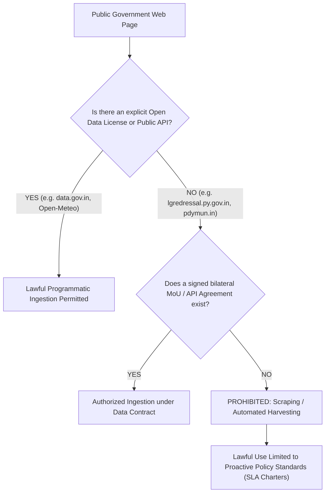

# Nirvaha Phase 5C.1 — Official Civic Data Source and Authorization Assessment

**Workspace:** `E:\Nirvaha`  
**Assessment Date:** 2026-10-15  
**Scope:** Puducherry Union Territory Civic Data Ingestion, Government Gateways, Legal Authorization, and Minimum Data Contracts  
**Status:** COMPLETE (Zero Unauthorized Scraping, Strict Data Classification Boundaries)

---

## 1. Executive Summary & Foundational Principles

This assessment determines which official Union Territory of Puducherry civic-service, grievance, and municipal records Nirvaha can **lawfully, ethically, and technically ingest**.

### Core Tenets of Nirvaha Civic Data Governance:
1. **Public Viewability Is Not Ingestion Permission:** A webpage that is publicly accessible in a web browser does **not** grant legal or technical permission to programmatically crawl, scrape, reverse-engineer, or store transactional civic records.
2. **Zero Fictitious Authorization:** Nirvaha must never claim or simulate an existing Memorandum of Understanding (MoU), API key, or government partnership where none formally exists in writing.
3. **Data Classification Isolation:** Under no circumstances may resident-submitted complaints, verified government administrative records, external environmental telemetry, or simulated stress scenarios be mixed or co-mingled.
4. **Digital Personal Data Protection (DPDP Act, 2023) Compliance:** Citizen grievance submissions in official government portals frequently contain sensitive personal data (names, mobile numbers, Aadhaar or ration card references, residential addresses, and confidential petition details). Ingesting these without explicit statutory consent or formal inter-agency data-sharing agreements violates Indian privacy law.
5. **Clear GO / NO-GO Decisions:** Every external candidate source must have an unambiguous operational decision based on verifiable technical endpoints and confirmed authorization.

---

## 2. Detailed Source-by-Source Investigation

### 2.1 Puducherry LG's Petition Monitoring System (PGRS / LG Grievance Desk)
- **Official URL:** `https://lgredressal.py.gov.in/pgrs/`
- **Responsible Authority:** Lieutenant Governor’s Secretariat, Raj Nivas, Puducherry.
- **Technical Custodian:** National Informatics Centre (NIC), Puducherry UT Centre.
- **Underlying Technology:** Microsoft IIS / ASP.NET 4.0 (`.aspx`), session-state cookies (`ASP.NET_SessionId`), frame-ancestors restriction (`SAMEORIGIN`), strict CSRF and session timeout enforcement.
- **Current Operational Mechanics:**
  - Citizen portal for filing grievances directed to the Lieutenant Governor.
  - Generates unique petition registration numbers (e.g., `PY/LG/2026/...`) for public status tracking.
  - Features an administrative back-office portal (`/pgrs/Admin/login.aspx`) for designated nodal officers across departments.
  - Maintains an isolated "Confidential Desk" for sensitive complaints.
- **API Availability:** **None.** No public REST API, GraphQL endpoint, RSS feed, or open JSON export exists.
- **Legal & Privacy Assessment:**
  - Citizen petitions contain full petitioner names, contact numbers, email IDs, physical home addresses, and narrative descriptions of grievances against public officials or departments.
  - Unauthorized automated scraping or brute-force tracking violates the Information Technology Act (2000), Section 43 (unauthorized access to computer systems) and the Digital Personal Data Protection Act (2023).
- **Access Granted Status:** **NO.** No inter-departmental MoU or developer API credentials have been issued to Nirvaha.
- **Assessment Decision:** **NO-GO for Programmatic Record Sync.**
  - **Permitted Use:** Nirvaha may cite published escalation hierarchies and jurisdiction guidelines as civic governance standards.
  - **Next Action Needed:** Formal request letter from the administrative sponsor to the Principal Secretary to the Lieutenant Governor and State Informatics Officer (NIC Puducherry) requesting an authorized, token-authenticated REST push/pull API with automatic PII redaction.

---

### 2.2 Pondicherry Municipality Grievance Redressal Desk (`pdymun.in`)
- **Official URL:** `https://pdymun.in/` / `https://pdymun.in/grievance-redressal.php`
- **Responsible Authority:** Pondicherry Municipality, Local Administration Department, Govt. of Puducherry (Marie Building, Dumas Street, covering 42 urban municipal wards).
- **Underlying Technology:** LiteSpeed Web Server, PHP application stack, municipal informational web pages and interactive complaint request forms.
- **Current Operational Mechanics:**
  - Web forms for registering local civic complaints (solid waste, road repair, streetlights, drainage overflows, tax queries).
  - Manual routing by municipal grievance officers to respective engineering and public health sections.
  - Public helpline: Municipal desk / State Toll-Free 1031.
- **API Availability:** **None.** No public REST API, webhook system, or structured JSON export is published.
- **Legal & Privacy Assessment:**
  - Complaints contain citizen identities, telephone numbers, and residential door addresses.
  - Automated form submission or scraping bypasses municipal administrative oversight.
- **Access Granted Status:** **NO.** No API agreement or bilateral integration clearance exists.
- **Assessment Decision:** **NO-GO for Direct Ingestion of Grievance Records.**
  - **Permitted Use:** Codification of published municipal engineering service turnaround standards (road restoration 14 days, drainage clearing 3 days, streetlight maintenance 3 days) in Nirvaha's `service_rules` catalog.
  - **Next Action Needed:** Prepare a Technical Integration Brief for the Municipal Commissioner, Pondicherry Municipality, proposing a pilot integration for non-sensitive, aggregated ward-level sanitation and drainage work orders.

---

### 2.3 Puducherry Public Works Department (PWD) Citizen's Charter
- **Official URL:** `https://pwd.py.gov.in/citizens-charter`
- **Responsible Authority:** Public Works Department, Govt. of Puducherry (Chief Engineer's Office; Roads, Buildings, Irrigation, and Public Health / Underground Sewerage Divisions).
- **Underlying Technology:** Government portal on `py.gov.in` domain. *Live Operational Note:* Live public portal currently encounters network connection timeouts / expired TLS certificates.
- **Available Resources:**
  - Published statutory policy documents: *PWD Citizen's Charter 2024–2025*.
  - Section 3.1: Statutory 15-day timeline for rectification of road potholes and obstructions.
  - Section 2.0: Statutory 3-day timeline for underground sewerage and drainage overflows.
  - Division guidelines for drinking water pipeline bursts (24h operational response).
- **API Availability:** **None.** The PWD operates internal physical registers and decentralized divisional order books; there is no live work-order REST API.
- **Legal & Privacy Assessment:**
  - The Citizen's Charter is an official public policy document gazetted under Section 4(1)(b) of the Right to Information Act (proactive disclosure).
  - Referencing statutory turnaround timelines does not involve PII or copyright infringement.
- **Access Granted Status:**
  - **Policy Standards:** **YES (Public Domain / Official Publication).**
  - **Live Work-Order Data:** **NO (No API exists).**
- **Assessment Decision:**
  - **Statutory Charter & SLA Rules:** **GO.** Already fully codified in Nirvaha's `service_rules` engine.
  - **Live Work-Order Ingestion:** **NO-GO.** Unavailable due to lack of municipal IoT or departmental digital API.
  - **Next Action Needed:** Coordinate with PWD IT nodal officers when state gateway certificates are renewed to evaluate whether future digital work orders will be exposed on the State Data Centre (SDC).

---

### 2.4 Open Government Data (OGD) Platform India (`data.gov.in`)
- **Official URL:** `https://data.gov.in/` / `https://data.gov.in/catalogs/?sector_title=Puducherry`
- **Responsible Authority:** National Informatics Centre (NIC), Ministry of Electronics and Information Technology (MeitY), Government of India.
- **Underlying Technology:** Open Data Platform with documented REST API (`https://api.data.gov.in/resource/{resource_id}`), supporting JSON, XML, and CSV endpoints with mandatory API-key headers.
- **Available Puducherry Datasets:**
  - Administrative boundary lists, commune panchayat master catalogs.
  - Healthcare centers, government schools, public distribution system (PDS) fair price shops.
  - Master infrastructure assets and geographic landmark catalogs.
  - *Limitation:* Does **not** host real-time citizen grievance transactions or live municipal maintenance work orders.
- **Licensing & Legal Status:**
  - **Open Government Data License - India (OGDL-India)**.
  - Explicitly permits public and commercial reuse, adaptation, and integration, subject to mandatory attribution: *"Source: Data.gov.in / National Informatics Centre (NIC)"*.
- **Access Granted Status:** **APPROVED / ELIGIBLE.** Open to any registered Indian civic developer using a provisioned OGD API Key.
- **Assessment Decision:** **GO (with Data Contract) for Reference & Infrastructure Catalogs.**
  - **Permitted Use:** Master catalogs of civic assets, ward identifiers, and administrative reference data.
  - **NO-GO:** Transactional grievance records (none exist on OGD).
  - **Next Action Needed:** Provision an official Nirvaha organization API key on `data.gov.in` and establish scheduled quarterly synchronization for Puducherry public infrastructure catalogs.

---

### 2.5 Puducherry Local Administration Department (LAD) Delimitation & Maps
- **Official URL:** `https://lad.py.gov.in/` / `https://lad.py.gov.in/maps`
- **Responsible Authority:** Local Administration Department, Govt. of Puducherry.
- **Underlying Technology:** Official UT departmental portal, publishing gazetted delimitation orders, ward boundary descriptions, and spatial GIS references (`stategisportal.nic.in`).
- **Available Resources:**
  - Puducherry Delimitation Commission Gazette notifications.
  - Municipal ward boundaries (42 wards of Pondicherry Municipality, 42 wards of Oulgaret Municipality, and commune panchayats).
  - Master ward numbers, names, and geographic extents.
- **API Availability:** Static gazettes and maps; no dynamic transactional API.
- **Licensing & Legal Status:** Official gazetted statutory boundary definitions in the public domain.
- **Access Granted Status:** **YES for Spatial Boundaries.** Master ward boundaries are already verified and codified in Nirvaha's `administrative_areas` database.
- **Assessment Decision:** **GO for Geographic & Jurisdiction Boundaries.**
  - **NO-GO:** Live grievance ingestion (LAD routes grievances to municipal desks or LG portal).
  - **Next Action Needed:** Maintain annual review of delimitation gazettes for ward restructuring or renaming notifications.

---

### 2.6 India Meteorological Department (IMD) API Platform
- **Official URL:** `https://api.imd.gov.in` / `https://mausam.imd.gov.in`
- **Responsible Authority:** India Meteorological Department, Ministry of Earth Sciences (MoES), Govt. of India.
- **Underlying Technology:** Enterprise API Gateway (`api.imd.gov.in`) with JWT bearer tokens, `X-API-KEY` authentication, rate limiting, and IP whitelisting.
- **Available Feeds:**
  - City 7-day weather forecasts.
  - Station-level nowcasts (3-hour extreme weather updates).
  - District daily and cumulative rainfall statistics.
  - Severe weather warnings (cyclone, heavy monsoon cloudburst).
- **Authentication & Authorization Requirements:**
  - Requires institutional developer registration on `api.imd.gov.in`.
  - Approval by IMD IT/NWP Division (New Delhi).
  - Execution of an official Data Sharing Undertaking.
- **Access Granted Status:** **PENDING CREDENTIALS (`NOT_CONFIGURED`).**
  - Nirvaha has built the production adapter (`ImdWeatherAdapter.java`), which strictly reports `NOT_CONFIGURED` and prevents any simulated data generation.
- **Assessment Decision:** **GO (Conditional on MoES Key Provisioning).**
  - Zero simulated records permitted in production until official keys are validated.
  - **Next Action Needed:** Submit institutional developer application to MoES/IMD under the Government of Puducherry disaster preparedness quota to receive official API credentials.

---

### 2.7 Open-Meteo Real-Time Weather & Forecast API
- **Official URL:** `https://api.open-meteo.com/v1/forecast`
- **Provider:** Open-Meteo / ECMWF / DWD National Weather Service data models.
- **Underlying Technology:** High-availability REST API, 15-minute and hourly resolution, public endpoint with no API key requirement for low-to-moderate civic volumes.
- **Available Feeds:** Real-time temperature (°C), relative humidity (%), current precipitation (mm), and 24-hour forward rainfall forecast (mm) for coordinates (11.9156° N, 79.8296° E).
- **Licensing & Permitted Use:** Creative Commons Attribution 4.0 (CC BY 4.0) and Open Database License (ODbL). Permitted for open civic applications with attribution.
- **Access Granted Status:** **ACTIVE & VERIFIED (`CONNECTED`).**
- **Assessment Decision:** **GO.** Active primary real-time atmospheric observation feed.
  - Must remain strictly attributed as Open-Meteo.
  - Must never be labeled or confused with official IMD telemetry.

---

## 3. Public Web Visibility vs. Programmatic Data Reuse Rights

A critical legal and ethical vulnerability in civic tech is confusing **what a citizen can view on a browser screen** with **what a platform can scrape, extract, or republish**.



### Statutory Framework Summary:

| Legislation / Standard | Legal Implication for Nirvaha |
| :--- | :--- |
| **Digital Personal Data Protection (DPDP) Act, 2023** | Ingesting citizen grievance records without explicit consent is illegal. Government grievance records containing names, mobile numbers, and residential addresses are protected digital personal data. Scraping them violates Section 4 and Section 6 of the DPDP Act. |
| **Information Technology Act, 2000 (Section 43 & 66)** | Bypassing session tokens, automated screen scraping of ASP.NET/LiteSpeed government portals, or reverse-engineering internal endpoints constitutes unauthorized access. |
| **Right to Information Act, 2005 (Section 4(1)(b))** | Proactively disclosed public documents (Citizen's Charters, statutory service turnaround standards, administrative delimitations) are official public policy and can be lawfully codified into Nirvaha's service rules engine. |
| **National Data Sharing and Accessibility Policy (NDSAP)** | Datasets published on `data.gov.in` under OGDL-India are pre-authorized for programmatic consumption with mandatory attribution. |

---

## 4. Minimum Data Contract for Authorized Civic Integration

Should the Government of Puducherry or the Municipal Administration formalize an authorized API gateway with Nirvaha (via an NIC MoU or municipal data exchange), the ingestion pipeline **MUST enforce the following strict Data Contract**:

```json
{
  "$schema": "https://nirvaha.gov.in/schemas/v1/authorized-civic-record.json",
  "title": "Nirvaha Authorized Civic Integration Record Contract",
  "type": "object",
  "required": [
    "externalRecordId",
    "sourceIdentifier",
    "sourceDepartment",
    "intakeMethod",
    "sourceTimestamp",
    "retrievalTimestamp",
    "category",
    "officialStatus",
    "location",
    "provenance"
  ],
  "properties": {
    "externalRecordId": {
      "type": "string",
      "description": "Unique immutable identifier from the originating government system (e.g., PY-PGRS-2026-08192).",
      "pattern": "^[A-Z0-9_-]{6,64}$"
    },
    "sourceIdentifier": {
      "type": "string",
      "enum": ["PUDUCHERRY_LG_PGRS", "PONDICHERRY_MUNICIPALITY", "PUDUCHERRY_PWD", "NIC_OGD_INDIA", "IMD_MOES"]
    },
    "sourceDepartment": {
      "type": "string",
      "description": "Specific municipal or state engineering wing (e.g., ENGINEERING_ROADS, DRAINAGE_SEWERAGE, PUBLIC_HEALTH)."
    },
    "intakeMethod": {
      "type": "string",
      "enum": ["OFFICIAL_REST_WEBHOOK", "AUTHORIZED_BATCH_PULL", "MUTUAL_TLS_EXCHANGE"]
    },
    "sourceTimestamp": {
      "type": "string",
      "format": "date-time",
      "description": "Original registration timestamp in the government database (ISO-8601 with timezone)."
    },
    "retrievalTimestamp": {
      "type": "string",
      "format": "date-time",
      "description": "Exact moment Nirvaha received and validated the payload."
    },
    "category": {
      "type": "string",
      "enum": ["POTHOLE", "DRAINAGE", "WATER_SUPPLY", "GARBAGE", "STREETLIGHT", "OTHER"]
    },
    "officialStatus": {
      "type": "string",
      "enum": ["REGISTERED", "ASSIGNED", "IN_PROGRESS", "WORK_COMPLETED", "RESOLVED", "REJECTED"]
    },
    "officialSlaDays": {
      "type": "integer",
      "description": "Statutory resolution turnaround target under the relevant Citizen's Charter."
    },
    "location": {
      "type": "object",
      "required": ["assignedWardCode", "accuracyLevel"],
      "properties": {
        "latitude": { "type": ["number", "null"], "minimum": 11.5, "maximum": 12.5 },
        "longitude": { "type": ["number", "null"], "minimum": 79.5, "maximum": 80.2 },
        "assignedWardCode": { "type": "string", "description": "Official municipal ward code (e.g., PY-WARD-05)." },
        "accuracyLevel": { 
          "type": "string", 
          "enum": ["EXACT_GPS", "STREET_INTERSECTION", "WARD_CENTROID_PRIVACY_OBSCURED"] 
        }
      }
    },
    "provenance": {
      "type": "object",
      "required": ["classification", "isSimulated", "rawPayloadHashSha256", "piiRedacted"],
      "properties": {
        "classification": { 
          "type": "string", 
          "enum": ["AUTHORIZED_GOVERNMENT_RECORD", "OFFICIAL_STATUTORY_RULE"] 
        },
        "isSimulated": { "type": "boolean", "enum": [false] },
        "rawPayloadHashSha256": { 
          "type": "string", 
          "description": "Cryptographic SHA-256 hash of the sanitized source payload for tamper-evidence." 
        },
        "piiRedacted": { 
          "type": "boolean", 
          "description": "Must be true. All citizen names, phone numbers, and private residential numbers must be removed." 
        },
        "redactedFields": {
          "type": "array",
          "items": { "type": "string" }
        }
      }
    }
  }
}
```

### Mandatory Ingestion Gateway Safeguards:
1. **Mandatory PII Scrubbing:** Any payload arriving with citizen names, mobile numbers, or email addresses must be scrubbed at the gateway before persistence.
2. **Cryptographic Provenance:** The sanitized payload must be hashed with SHA-256 (`rawPayloadHashSha256`) to ensure auditability and tamper detection.
3. **Immutability of Source Timestamp:** The system must never overwrite `sourceTimestamp` with `retrievalTimestamp`.
4. **Zero Entity Contamination:** Ingested external government records must never be saved into the citizen crowdsourced incident table (`incidents`) without explicit `AUTHORIZED_GOVERNMENT_RECORD` flags and external ID tracking.

---

## 5. Source-by-Source Assessment Matrix & Integration Decisions

| Source Candidate | Authority | Integration Method | Authorization Status | Risk Assessment | Operational Decision |
| :--- | :--- | :--- | :--- | :--- | :--- |
| **LG Petition Monitoring System (PGRS)** | LG Secretariat / NIC | None (Web UI only) | **NO AUTHORIZATION** | High PII risk; IT Act violation if scraped | **NO-GO (Zero Ingestion)** |
| **Pondicherry Municipality Grievance Desk** | Pondicherry Municipality | None (PHP form / phone) | **NO AUTHORIZATION** | High PII risk; no structured API | **NO-GO (Zero Ingestion)** |
| **PWD Citizen's Charter** | PWD Puducherry | Gazetted Policy / Charter | **PUBLIC PROACTIVE DISCLOSURE** | Low risk; official policy text only | **GO (Policy & SLA Codification)** |
| **Open Government Data (data.gov.in)** | NIC / MeitY | REST API (API Key) | **AUTHORIZED UNDER OGDL-INDIA** | Negligible; public open data catalogs | **GO (Asset Catalogs & GIS)** |
| **Puducherry LAD Ward Delimitation** | LAD Puducherry | Gazette / State GIS | **PUBLIC STATUTORY DEFINITIONS** | Negligible; official administrative boundaries | **GO (Jurisdictions & Boundaries)** |
| **India Meteorological Dept. (IMD)** | MoES / IMD | API Gateway (`X-API-KEY`) | **PENDING REGISTRATION** | Zero if unconfigured; high fidelity when keyed | **GO (Conditional on Official Key)** |
| **Open-Meteo Weather API** | Open-Meteo / ECMWF | Public REST API | **APPROVED UNDER CC BY 4.0** | Negligible; environmental telemetry only | **GO (Active Telemetry)** |

---

## 6. Prohibited Anti-Patterns & Operational Safeguards

During this and all subsequent phases, Nirvaha enforces the following strict prohibitions:

1. **NO HTML Screen Scraping:** Never write headless browser or Python/cURL scrapers against `lgredressal.py.gov.in` or `pdymun.in`.
2. **NO Credential Spoofing or Fake MoUs:** Never assert in UI badges, API documentation, or reports that an MoU exists with Raj Nivas, NIC, or the Municipality until an executed agreement is officially filed.
3. **NO Synthetic Official Records:** Never fabricate simulated records that pretend to be "Verified Government Records" or "Official IMD Feeds". Simulated test runs must always carry the explicit prefix `[SIMULATED]` and `intake_source = SIMULATED`.
4. **NO Silent Coercion:** Missing external data must remain `null` or `UNAVAILABLE`; it must never become zero or safe defaults.

---

## 7. Roadmap & Next Institutional Actions (Phase 5C Transition)

To transition ethically and lawfully toward authorized government data sharing:

1. **Phase 5C.2 (Institutional Liaison):**
   - Submit formal Technical Integration Proposal to the Department of Information Technology (DIT) and Local Administration Department (LAD), Government of Puducherry.
   - Request integration via the Puducherry State Data Centre (SDC) API gateway for aggregated, anonymized ward-level civic grievances.
2. **Phase 5C.3 (IMD Developer Account):**
   - Complete developer registration on `api.imd.gov.in` under the institutional government user category to obtain legitimate `X-API-KEY` credentials.
3. **Phase 5C.4 (OGD Platform Integration):**
   - Generate OGD India API token on `data.gov.in` to automate quarterly synchronization of Puducherry civic infrastructure and public asset layers.

---

## 8. Conclusion

Nirvaha's data architecture is founded on **provenance integrity, privacy compliance, and absolute transparency**. Official citizen charters, ward delimitations, and open environmental telemetry are active and verified. Transactional grievance records from the LG PGRS and Pondicherry Municipality remain strictly **NO-GO** until formal, authorized APIs with automatic PII redaction are established by the respective authorities.
