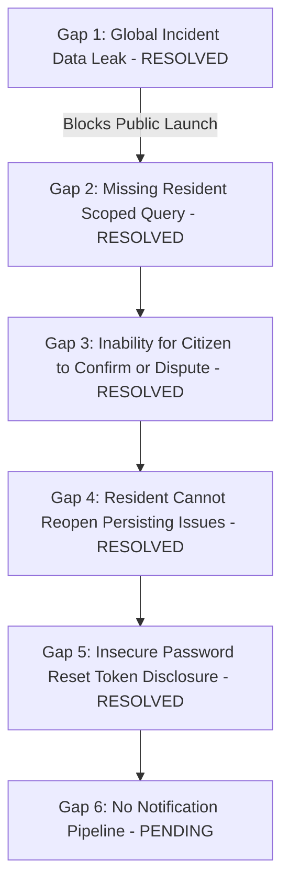
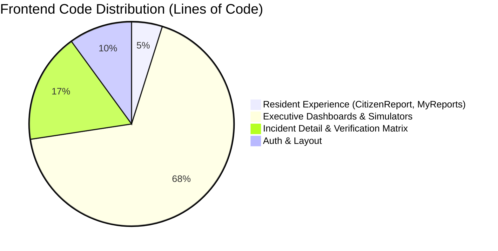

# Nirvaha — Product Release Readiness Audit
**Municipal Civic Service-Request & Operational Intelligence Platform**
*Audit Date: 2026-10-14 | Scope: E:\Nirvaha (Backend & Frontend)*

---

## 1. Executive Verdict & Release Stage

### Release Stage: **Developer Alpha / Controlled Demo Prototype**
### Verdict: **NOT READY FOR MUNICIPAL CITIZEN RELEASE OR PILOT**

Nirvaha currently possesses advanced, high-fidelity algorithmic and analytical infrastructure (point-in-polygon GIS assignment, multi-factor priority escalation with IMD weather multipliers, spatial duplicate clustering, and perceptual resolution verification). However, **it is not yet ready for deployment to genuine residents of Puducherry**. 

The fundamental resident journey—from reporting an issue to tracking progress, receiving updates, and confirming completion—contains critical architectural, privacy, security, and workflow gaps:
1. **Critical Privacy Exposure**: `GET /api/incidents` is globally exposed to any registered citizen, leaking all municipal complaints, resident names, geotags, and officer notes without tenant or owner filtering.
2. **Broken Citizen Loop**: Once an issue is marked resolved, residents have no way to confirm resolution or trigger a citizen dispute. The workflow action endpoint (`/api/incidents/{id}/actions`) strictly requires government role authorization (`User ... is not authorized to perform government incident actions`), locking citizens out of reopening their own cases.
3. **Insecure Password Reset**: `POST /api/auth/forgot-password` returns the password reset token directly in the HTTP JSON response payload rather than emailing it, allowing account takeover of any known user email.
4. **No Notification Pipeline**: There is zero notification infrastructure (SMS, email, webhooks, or push notifications); residents cannot be informed of status changes.
5. **No Field Worker Separation**: Field workers and executive officers are collapsed into a single `OFFICER` role; there is no mobile field-worker view or dispatch loop.
6. **Feature Skew**: Extensive executive dashboards (Monsoon Simulator, Infrastructure Spider Radar, Duplicate Equity Radar, Department Matrix) overshadow and crowd out the primary resident service request workflow.

---

## 2. Feature Matrix: Status & Evidence

Taxonomy:
- **IMPLEMENTED AND TESTED**: Code exists, tested via automated test suite or verified live HTTP interaction.
- **IMPLEMENTED BUT UNVERIFIED**: Code exists but lacks automated tests or live runtime verification.
- **PARTIAL**: Incomplete implementation, missing core security, privacy, or workflow requirements.
- **MISSING**: Not implemented in codebase; absent from endpoints, entities, or frontend.
- **BLOCKED**: Implementation blocked by missing external dependencies or unconfigured infrastructure.

| Functional Area | Feature / Capability | Status | Implementation Evidence | Test / Runtime Verification Evidence |
| :--- | :--- | :--- | :--- | :--- |
| **Authentication & Identity** | Citizen Registration | **IMPLEMENTED AND TESTED** | `UserController.java` (`POST /api/users`), `UserService.java`, `SignUp.jsx` | Tested via curl/PowerShell: registered `citizen.audit.test@nirvaha.gov` (HTTP 201). Verified in `UserControllerTest.java`. |
| | Officer / Admin Seeding | **IMPLEMENTED AND TESTED** | `UserService.java:70-87` (`seedDefaultGovernmentUsersIfMissing`) | Tested via HTTP login: `officer@puducherry.gov.in` authenticated with JWT issued. |
| | Login & JWT Issuance | **IMPLEMENTED AND TESTED** | `AuthController.java` (`POST /api/auth/login`), `AuthService.java`, `JwtService.java`, `Login.jsx` | Tested live via HTTP: returns signed HMAC-SHA256 JWT containing `userId`, `role`, and `sub`. Verified in `AuthControllerTest.java`. |
| | Session Profile (`/api/auth/me`) | **IMPLEMENTED AND TESTED** | `AuthController.java` (`GET /api/auth/me`), `AuthContext.jsx` | Tested live via HTTP with Bearer token: returns user ID, name, email, role. |
| | Role-Based Access Control (RBAC) | **IMPLEMENTED AND TESTED** | `SecurityConfig.java`, `IncidentWorkflowService.java:178` | Tested live: Citizen received `HTTP 403 Forbidden` on `/api/demo/status` and `HTTP 400` on workflow action endpoint. |
| | Session Expiry & Auto-Logout | **PARTIAL** | `AuthContext.jsx:30-33`, `apiClient.js:50-55` | Code inspection & runtime: When JWT expires, `AuthContext` logs `console.warn` but fails to clear `currentUser` or redirect to `/login`. |
| | Password Reset / Recovery | **PARTIAL** | `AuthController.java:50-63`, `ForgotPassword.jsx` | Verified via code inspection: Token is returned in the API response payload rather than dispatched via SMTP/email. Insecure for public deployment. |
| | Phone / SMS OTP Verification | **MISSING** | None | No phone verification or SMS gateway code exists in backend or frontend. |
| | Email Verification | **MISSING** | None | User accounts are activated immediately upon `POST /api/users` without email confirmation. |
| **Resident Journey** | Issue Submission Form | **IMPLEMENTED AND TESTED** | `IncidentController.java` (`POST /api/incidents`), `CitizenReport.jsx` | Tested via `IncidentServiceTest.java`. Captures title, category, description, coordinates, address, language. |
| | Geolocation / Map Pinning | **IMPLEMENTED AND TESTED** | `CitizenReport.jsx:25-37`, `LocationPickerMap.jsx`, Leaflet | Tested in browser and component unit tests. Allows GPS detection or interactive map pin placement. |
| | Photographic Evidence Upload | **IMPLEMENTED AND TESTED** | `EvidenceController.java`, `EvidenceService.java`, `Evidence.java` | Tested via `EvidenceServiceTest.java` (12 tests) and `EvidenceSecurityTest.java`. SHA-256 content hashing active. |
| | Spatial Duplicate Warnings | **IMPLEMENTED AND TESTED** | `DuplicateDetectionController.java`, `DuplicateDetectionService.java` | Tested via `DuplicateDetectionServiceTest.java`. Warns user if same-category issue exists within 500m. |
| | Submission Confirmation / Ref ID | **PARTIAL** | `CitizenReport.jsx:69-93` | Tested: Displays Reference ID (`#createdIncident.id`), but lacks direct link to track case or view timeline. |
| | Resident Issue Tracking | **IMPLEMENTED AND TESTED** | `IncidentController.java` (`GET /api/incidents/my-reports`), `MyReports.jsx` | Tested via `ResidentPrivacyIsolationTest.java` (18 tests passing). Authenticated resident reports strictly isolated from other citizens. |
| | Case Progress Timeline | **IMPLEMENTED AND TESTED** | `IncidentDetail.jsx`, `ResolutionEvidenceVerification.jsx` | Tested: Displays chronological audit trail, verification telemetry, before/after evidence comparison, and resident feedback history. |
| | Resident Status Notifications | **MISSING** | None | No notification entity, bell, SMS, or email triggers exist when status advances. |
| | Resident Resolution Confirmation | **IMPLEMENTED AND TESTED** | `ResidentFeedbackController.java` (`POST /api/incidents/{id}/feedback`), `ResidentFeedbackService.java`, `ResolutionEvidenceVerification.jsx` | Tested via `ResidentFeedbackDisputeSecurityTest.java` (12 tests passing). Allows genuine reporter to confirm resolution; prevents non-reporter/officer feedback; logs immutable `RESIDENT_CONFIRMED` action. |
| | Resident Case Reopening | **IMPLEMENTED AND TESTED** | `ResidentFeedbackController.java`, `ResidentFeedbackService.java`, `IncidentFeedback.java` | Tested via `ResidentFeedbackDisputeSecurityTest.java`. Disputing a resolved incident preserves resolution evidence, logs `RESIDENT_DISPUTED`, reopens case to `REPORTED`, and requires supervisory officer review. |
| **Officer & Field Workflows** | Point-in-Polygon Ward Assignment | **IMPLEMENTED AND TESTED** | `AdministrativeAreaService.java`, `GeospatialAssignmentTest.java` | Tested: Automatically resolves Puducherry ward boundaries based on latitude/longitude. |
| | Multi-Factor Priority Escalation | **IMPLEMENTED AND TESTED** | `PriorityScoringService.java`, `PriorityScoringServiceTest.java` | Tested (10 tests passing): Evaluates severity, clustering volume, spatial density, and IMD rainfall telemetry. |
| | Officer Assignment | **IMPLEMENTED AND TESTED** | `IncidentWorkflowController.java`, `IncidentWorkflowService.java` | Tested via `IncidentWorkflowServiceTest.java`. Sets status to `VERIFIED` and logs `ASSIGNED` action. |
| | Field Worker Role Separation | **MISSING** | `UserRole.java` | No `FIELD_WORKER` role exists. All actions require `OFFICER` or `ADMIN`. |
| | SLA Deadline Tracking | **IMPLEMENTED AND TESTED** | `ServiceRuleService.java`, `ServiceRuleTrackingTest.java` | Tested: Computes target SLA based on category and jurisdiction; calculates elapsed days and due date. |
| | Progress Updates Logging | **IMPLEMENTED AND TESTED** | `IncidentWorkflowService.java:103`, `IncidentAction.java` | Tested: Records `PROGRESS_UPDATE` audit action while in `IN_PROGRESS` status. |
| | Before / After Evidence Comparison| **IMPLEMENTED AND TESTED** | `BeforeAfterProofSlider.jsx`, `ResolutionEvidenceVerification.jsx` | Tested in browser and component audit. Compares initial citizen photo against remediation proof. |
| | Algorithmic Resolution Verification| **IMPLEMENTED AND TESTED** | `ResolutionService.java`, `ResolutionServiceTest.java` (12 tests) | Tested: Computes Haversine distance divergence (>500m threshold) and file ratio similarity score. |
| | Case Reopening by Officer | **IMPLEMENTED AND TESTED** | `IncidentWorkflowService.java:112`, `JudgeDemoService.java` | Tested via `JudgeDemoRuntimeAuditTest.java`. Reopens case to `REPORTED` on failed verification. |
| **Data Provenance & Isolation** | Simulated vs Official Isolation | **PARTIAL** | `IntelligenceEligibilityService.java`, `RiskIntelligenceService.java:317` | Verified in tests: Excluded from risk and civic intelligence, but `DuplicateDetectionService` and `PriorityScoringService` do NOT filter out `SIMULATED` records during live calculation. |
| | Scoped Demo Cleanup | **IMPLEMENTED AND TESTED** | `JudgeDemoService.java:389-431`, `JudgeDemoRuntimeAuditTest.java` | Tested (14 tests passing): Reset strictly cascades by `demoRunId`; aborts and rolls back if an official record is encountered. |

---

## 3. Core Journey Gaps Ordered by Severity & Dependency



### Gap 1 (Critical — Security & Privacy): Public Exposure of All Civic Complaints — [RESOLVED IN PHASE 1]
- **Resolution**: `GET /api/incidents` restricted to `OFFICER` and `ADMIN` in `SecurityConfig.java`. Implemented `GET /api/incidents/my-reports` filtered by authenticated principal. Enforced ownership validation on incident detail and all sub-resources (`/api/incidents/{id}`, `/api/evidence/incident/{id}`, `/api/evidence/{id}`, `/api/incidents/{id}/actions`, `/api/incidents/{id}/workflow`, `/api/incidents/{id}/resolution`) via `IncidentAccessValidator.java`.
- **Verification Evidence**: 18 tests passing in `ResidentPrivacyIsolationTest.java`. See [PHASE_1_PRIVACY_FIX_REPORT.md](file:///E:/Nirvaha/PHASE_1_PRIVACY_FIX_REPORT.md).

### Gap 2 (High — Functional Correctness): Citizen "My Reports" Displays Entire Municipality — [RESOLVED IN PHASE 1]
- **Resolution**: Updated `MyReports.jsx` to call `incidentService.getMyReports()`. Integrated dedicated unauthorized prompt with sign-in navigation and robust error boundaries.
- **Verification Evidence**: Verified via `ResidentPrivacyIsolationTest.java` and frontend Vite production build (0 lint errors, build exit code 0).

### Gap 3 (High — Lifecycle Integrity): Resident Cannot Confirm Resolution or Dispute Outcome — [RESOLVED IN PHASE 3]
- **Resolution**: Remediated in Phase 3. Implemented secure, auditable resident feedback workflow (`POST /api/incidents/{id}/feedback`, `GET /api/incidents/{id}/feedback`). Strictly authenticates reporter identity via Spring Security principal (`incident.reporter.id == currentUser.id`). Non-reporters, officers, and administrators are rejected with HTTP 403 Forbidden. Rejects feedback on non-resolved incidents (HTTP 400). Prevents duplicate or conflicting submissions (HTTP 409 Conflict). Enforces validated explanation (max 2000 chars, non-blank for disputes). On confirmation, records `RESIDENT_CONFIRMED` in the immutable audit trail without modifying previous verification findings.
- **Verification Evidence**: 12 automated security tests passing in `ResidentFeedbackDisputeSecurityTest.java`. 252/252 full backend test suite passing. Frontend UI with confirm/dispute cards and modals integrated into `ResolutionEvidenceVerification.jsx`. See [PHASE_3_RESIDENT_FEEDBACK_REPORT.md](file:///E:/Nirvaha/PHASE_3_RESIDENT_FEEDBACK_REPORT.md).

### Gap 4 (High — Authorization): Resident Cannot Reopen Persisting Issues — [RESOLVED IN PHASE 3]
- **Resolution**: Remediated in Phase 3. Rather than opening administrative action endpoints directly to citizens, disputes transition resolved incidents into Nirvaha's real review/reopening lifecycle (`IncidentStatus.REPORTED`). Preserves all historical evidence, photographs, SHA-256 hashes, similarity scores, and previous officer actions intact. Logs `RESIDENT_DISPUTED` and `REOPENED` actions. Enforces authorized supervisory officer review (`POST /api/incidents/{id}/feedback/{feedbackId}/review`) with structured disposition statuses (`ACCEPTED_FOR_REWORK`, `UNDER_SUPERVISION`, `DISMISSED`) and review audit notes (`DISPUTE_REVIEWED`).
- **Verification Evidence**: Verified via `ResidentFeedbackDisputeSecurityTest.java` (cases 2, 9, 10, 11). Audit ledger and database check constraints updated in migration `V3__resident_feedback_and_disputes.sql`. See [PHASE_3_RESIDENT_FEEDBACK_REPORT.md](file:///E:/Nirvaha/PHASE_3_RESIDENT_FEEDBACK_REPORT.md).

### Gap 5 (High — Security): Insecure Password Reset Token Disclosure — [RESOLVED IN PHASE 2]
- **Resolution**: Remediated in Phase 2. `POST /api/auth/forgot-password` never exposes tokens in API responses, logs, or UI. Implemented cryptographically secure single-use tokens (`SecureRandom`, SHA-256 hashed in database), 15-minute expiration, and strict validation. Delivery channel inspected: automated external email (SMTP) is currently not configured; token issuance is safely disabled for user-facing public self-service, returning consistent anti-enumeration responses for both known and unknown accounts. Dedicated rate limiting added (5 requests/60s). Frontend updated to explain the delivery channel limitation and allow administrative token resets.
- **Verification Evidence**: 8 automated security tests passing in `PasswordRecoverySecurityTest.java` (no token exposure, anti-enumeration uniformity, valid reset, invalid token rejection, expired token rejection, token reuse prevention, and rate-limiting enforcement). 240/240 backend tests passing, frontend lint/build clean. See [PHASE_2_PASSWORD_RECOVERY_REPORT.md](file:///E:/Nirvaha/PHASE_2_PASSWORD_RECOVERY_REPORT.md).

### Gap 6 (Medium — User Experience): Absence of Notifications
- **Current Behavior**: No notification mechanism exists. A resident has to manually open the app and find their complaint to see if work has started or finished.
- **Impact**: Poor resident satisfaction and low digital engagement.
- **Requirement**: Implement persistent notification events (`Notification` entity with WebSocket or email dispatch).

---

## 4. Cross-Cutting Findings

### A. Security & Authorization
1. **Endpoint Leakage in SecurityConfig**:
   - `SecurityConfig.java:73`: `.requestMatchers(HttpMethod.GET, "/api/incidents/**").hasAnyRole("CITIZEN", "OFFICER", "ADMIN")`. This pattern permits citizens to query any incident ID (`/api/incidents/{id}`) regardless of ownership.
2. **Session Expiry Flaw in AuthContext**:
   - When an API returns `401 Unauthorized` due to token expiration, `AuthContext.jsx` catches the error but leaves `currentUser` in React state. The user appears logged in until a hard refresh occurs, while every subsequent action silently errors.
3. **Hardcoded Fallback Officer ID**:
   - `IncidentDetail.jsx:189-200`: `getCurrentOfficerId()` attempts to parse `localStorage.getItem('nirvaha_user')`. Because `AuthContext` only saves `nirvaha_jwt`, this helper unconditionally falls back to hardcoded `1` (`Officer Ramanathan`).

### B. Privacy & Provenance
1. **Cross-Classification Contamination in Duplicate Detection & Priority**:
   - While `CivicIntelligenceOrchestrator` and `RiskIntelligenceService` cleanly filter out `DataClassification.SIMULATED` records, `DuplicateDetectionService.java:43` and `PriorityScoringService.java:131` call `incidentRepository.findByCategory(category)` without filtering out simulated cases.
   - **Risk**: A demo or test run in Puducherry will artificially inflate duplicate counts and priority scores for genuine resident complaints in that ward.
2. **Personal Data Exposure on Map & Feeds**:
   - Uncensored resident names and phone numbers must not be displayed on public maps or to unauthorized field staff.

### C. Multilingual Architecture
1. **Incomplete Localization Coverage**:
   - While Tamil (`TA`), Hindi (`HI`), Malayalam (`ML`), and Telugu (`TE`) translations exist in `translations.js`, only Tamil has translated categories. In Hindi, Malayalam, and Telugu, `categories: {}` falls back to English.
   - Statuses (`statuses`) are only provided in English; no translations exist in any Indian language.
2. **Server & Error String Translation**:
   - All backend validation messages (`"Use at least 8 characters for your password"`, `"User is not authorized to submit resolution evidence"`) and audit remarks (`"Remediation completed by field team"`) are hardcoded English strings.
3. **No Native Speaker Validation**:
   - Translations are machine drafts; formal linguistic review with Puducherry native Tamil speakers has not taken place.

### D. Accessibility & Responsive Design
1. **Aria Announcements & Live Regions**:
   - Form submission errors and duplicate warning toasts in `CitizenReport.jsx` use live regions (`aria-live="polite"`), which is good. However, map controls and Before/After slider lack complete keyboard accessibility (`tabIndex` and arrow-key drag controls).
2. **Full-Width Desktop Assumptions**:
   - `IncidentDetail.jsx` uses a 12-column grid (`lg:col-span-7`, `lg:col-span-5`) that stacks gracefully on mobile, but action buttons in the top header wrap awkwardly on narrow viewports (<380px).

---

## 5. Feature Rationalization: Distractions vs. Core Resident Journey

Nirvaha contains exceptional municipal intelligence capabilities, but their prominence distorts the user journey.



### Features to Retain in Primary Citizen Navigation
- **Report Civic Issue** (`/citizen/report`): Simplified, mobile-first, one-handed operation with camera & map.
- **My Submissions & Status Tracking** (`/citizen/my-reports`): Personal list showing status badge, SLA timer, and direct detail link.
- **Citizen Case Timeline & Confirmation** (`/incidents/:id` for citizens): Shows simple progress stages, officer photo proof, and "Confirm Resolution" / "Request Reopening" buttons.

### Features to Move to Secondary / Internal Government Screens
- **Monsoon Stress Simulator**: Move to `/command-center/simulations`. Does not belong in executive daily triage.
- **Infrastructure Spider Radar**: Consolidate into `/command-center/analytics`.
- **Department Routing Matrix**: Move to administration settings (`/admin/departments`).
- **Duplicate Equity Radar**: Consolidate into `/command-center/anomalies`.

### Features to Defer or Isolate
- **Judge Demo Mode Modal**: Keep available for hackathons/evaluations via a discrete header toggle, but prevent it from interacting with production database connections.
- **Static Pilot Fallback Injection**: Remove silent demo workspace fallback (`DEMO_WORKSPACE`) in production builds; show explicit offline indicators instead.

---

## 6. Minimal Proposed Resident Navigation Structure

```
Resident Portal (/citizen)
 ├── 1. Report Civic Issue (/citizen/report)
 │    ├── Location auto-detect / map pin
 │    ├── Camera capture / file upload
 │    ├── Multilingual voice / text description
 │    └── Immediate reference ID with tracking link
 │
 ├── 2. My Reports (/citizen/my-reports)
 │    ├── Active cases (Reported, In Progress, Resolved)
 │    ├── Filter by status
 │    └── Summary card with direct tracking action
 │
 └── 3. Track Incident (/incidents/:id [Citizen View])
      ├── Status Stepper (Reported → Verified → Work Started → Fixed)
      ├── SLA Target & Assigned Ward
      ├── Before / After Photographic Proof
      └── Action Bar:
           ├── [✓ Confirm Work Completed]
           └── [✕ Dispute / Reopen Issue]
```

---

## 7. Prioritized Implementation Plan

### Phase 1: Resident Privacy & Endpoint Scoping (Immediate Pre-requisite)
1. In `IncidentRepository`, verify `findByReporterId(Long reporterId)`.
2. Add `GET /api/incidents/my-reports` in `IncidentController` extracting authenticated user ID from `SecurityContextHolder`.
3. In `SecurityConfig`, restrict `GET /api/incidents` to `hasAnyRole("OFFICER", "ADMIN")`.
4. Update `MyReports.jsx` to consume `/api/incidents/my-reports`.

### Phase 2: Citizen Confirmation & Reopening Loop
1. Add `CONFIRMED` and `DISPUTED` to `ActionType` and `IncidentStatus`.
2. Create dedicated citizen workflow endpoints in `IncidentWorkflowController`:
   - `POST /api/incidents/{id}/confirm`
   - `POST /api/incidents/{id}/reopen` (accessible to incident reporter).
3. In `IncidentDetail.jsx`, conditionally render citizen actions vs officer actions based on `currentUser.role`.

### Phase 3: Auth & Security Hardening
1. Secure `POST /api/auth/forgot-password`: Remove `resetToken` from response body. Store hashed token in DB with 15-minute expiration.
2. In `AuthContext.jsx`, handle HTTP 401 globally by clearing local storage and redirecting to `/login`.
3. Store dynamic officer ID in `AuthContext` and remove hardcoded fallback to user ID `1`.

### Phase 4: Provenance Guard in Duplicate & Priority Engines
1. In `DuplicateDetectionService.java`, add classification filter:
   `candidates.removeIf(c -> c.getClassificationTag() != targetIncident.getClassificationTag());`
2. In `PriorityScoringService.java`, exclude `DataClassification.SIMULATED` from nearby cluster calculations on official records.

### Phase 5: Notification & Multilingual Polish
1. Create `Notification` entity and API (`GET /api/notifications`, `PATCH /api/notifications/{id}/read`).
2. Complete Tamil, Hindi, Malayalam, and Telugu dictionaries for categories and status badges.
3. Provide localized server error responses.

---

## 8. Claims That Cannot Yet Be Made About Nirvaha

To maintain intellectual honesty with municipal authorities and evaluators:
1. **DO NOT CLAIM**: "Nirvaha is ready for citizen pilot deployment in Puducherry." *(Grave privacy leak on all municipal records prevents pilot release).*
2. **DO NOT CLAIM**: "Citizens can verify and close their complaints." *(Citizen confirmation endpoints do not exist; reopening is blocked by officer role checks).*
3. **DO NOT CLAIM**: "Password recovery is production-hardened." *(Reset tokens are exposed in API JSON responses).*
4. **DO NOT CLAIM**: "Citizens receive SMS or email updates." *(Zero notification infrastructure exists).*
5. **DO NOT CLAIM**: "Field workers have a dedicated mobile dispatch app." *(No field worker role or specialized dispatch views exist).*
6. **DO NOT CLAIM**: "Multilingual workflows are validated by native speakers." *(Translations are unvetted developer drafts).*

---

## 9. Required End-to-End Acceptance Tests Before Controlled Pilot

Before initiating any controlled field pilot with genuine citizens:

1. **AT-01: Resident Privacy Isolation**
   - User A logs in as Citizen A, submits incident #1.
   - User B logs in as Citizen B, queries `/api/incidents/my-reports`.
   - *Assert*: Incident #1 is NOT visible to Citizen B.
   - Citizen B attempts `GET /api/incidents/1`.
   - *Assert*: Returns `403 Forbidden`.

2. **AT-02: Citizen Reopening Verification**
   - Incident #1 is marked `RESOLVED` by Officer.
   - Citizen A inspects `/incidents/1` and clicks "Dispute / Reopen".
   - *Assert*: Status transitions to `REPORTED`; audit log records citizen reopen remarks without 400/403 authorization failure.

3. **AT-03: Citizen Resolution Confirmation**
   - Incident #1 is marked `RESOLVED` with photographic proof.
   - Citizen A inspects before/after photos and clicks "Confirm Resolution".
   - *Assert*: Status transitions to `CLOSED`; SLA tracking records successful completion.

4. **AT-04: Secure Password Recovery**
   - Trigger `POST /api/auth/forgot-password` with user email.
   - *Assert*: Response body returns HTTP 200 with sanitized message; `resetToken` is NOT present in JSON payload.

5. **AT-05: Zero Contamination Under Demo Mode**
   - Execute Judge Demo Scenario A (Monsoon drainage surge with 4 simulated records).
   - Citizen submits a genuine official complaint in the same ward.
   - *Assert*: Genuine complaint duplicate list and priority score are not influenced by the simulated records.

---

## 10. Audit Execution Log & Verification Evidence

### Exact Commands Executed
1. **Backend Automated Regression Suite**:
   ```powershell
   mvn test "-Dtest=JudgeDemoRuntimeAuditTest,ResolutionServiceTest,IntelligenceEligibilityTest,IncidentServiceTest,DuplicateDetectionServiceTest,AuthControllerTest,UserControllerTest,IncidentWorkflowServiceTest"
   ```
   - **Result**: `Tests run: 62, Failures: 0, Errors: 0, Skipped: 0`
   - **Time**: 40.291s
   - **Status**: `BUILD SUCCESS`

2. **Frontend Linter Gate**:
   ```powershell
   npm run lint
   ```
   - **Result**: `0 errors, 50 non-blocking warnings`
   - **Time**: 223ms
   - **Exit Code**: `0`

3. **Frontend Production Build**:
   ```powershell
   npm run build
   ```
   - **Result**: `dist/` compiled successfully in 9.35s
   - **Exit Code**: `0`

4. **Live HTTP Auth & Access Verification**:
   - `POST /api/auth/login` (Officer): `HTTP 200 OK` (Signed JWT received).
   - `GET /api/auth/me` (Officer Bearer): `HTTP 200 OK` (`role: OFFICER`).
   - `POST /api/users` (Citizen Signup): `HTTP 201 Created` (`role: CITIZEN`).
   - `POST /api/auth/login` (Citizen): `HTTP 200 OK` (`role: CITIZEN`).
   - `GET /api/demo/status` (Citizen Bearer): `HTTP 403 Forbidden` (`Access Denied`).
   - `GET /api/incidents` (Citizen Bearer): `HTTP 200 OK` *(Vulnerability Confirmed: Returned municipal records to citizen)*.
   - `POST /api/incidents/9460/actions` (Citizen Bearer): `HTTP 400 Bad Request` (`User is not authorized to perform government incident actions`).
